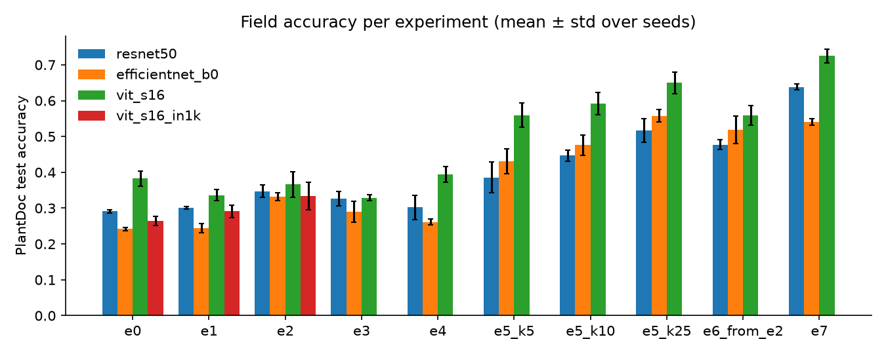
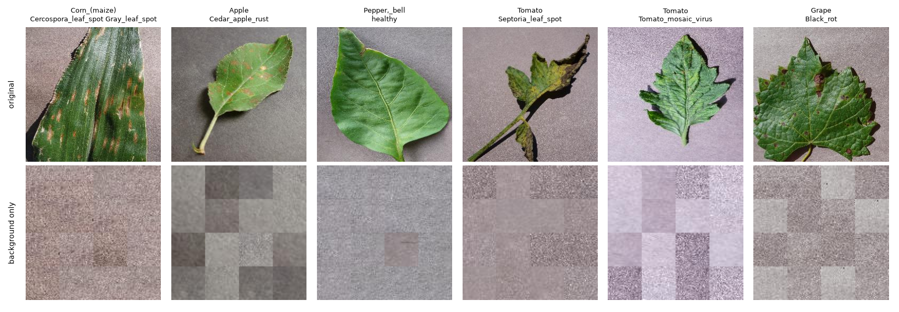
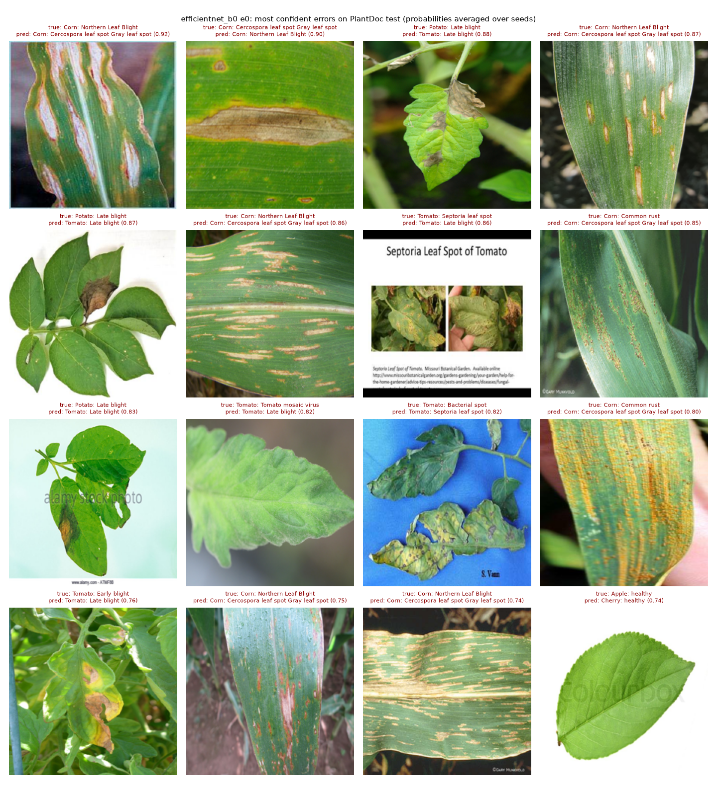
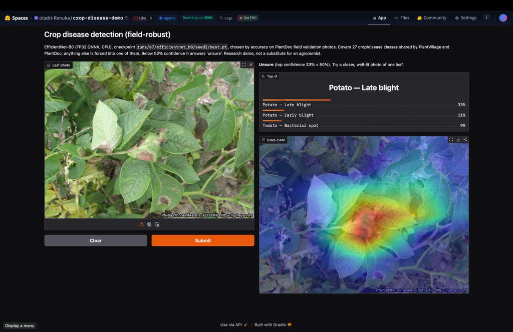

# Crop disease detection that works in real fields

[](https://huggingface.co/spaces/oladri-Renuka/crop-disease-demo)

> **Result:** classifiers trained on lab photos (PlantVillage, 99% accuracy) reach only **24–38% on field photos**
> (PlantDoc, 27 shared classes, 3 seeds). **Generative augmentation recovers little of that gap**: CycleGAN 10–16% of
> the achievable gain for CNNs, a conditional VAE ≤ 7%, neither significant after Holm correction. **Ten real field
> photos per class recover 45–78%**, significant for every model. No evidence that attention adds robustness beyond
> pretraining: ViT's lead comes with ImageNet-21k pretraining. **Demo:** https://huggingface.co/spaces/oladri-Renuka/crop-disease-demo



*Headline metric: **PlantDoc (field) test accuracy**, mean ± std over seeds 0–2. E0 lab only → E7 field only; E1–E4 are
lab-side fixes, E5 adds k real field photos per class. Created by `python -m src.report`.*

## How to run (3 commands)

```bash
make setup data                                                                       # install; download + prepare both datasets (~15 min)
python -m src.train --config configs/experiments/e0_baseline.yaml model=efficientnet_b0 seed=0   # one experiment (~25 min on an A40)
python -m src.report                                                                  # results tables, paired tests, figures -> reports/
```

Everything else is one script each, all resumable (finished runs are skipped): `bash scripts/run_experiments.sh`
(full E0–E7 sweep), `bash scripts/followups.sh` (ViT-1k control, shortcut test per architecture),
`bash scripts/analysis.sh` (curves, failure analysis, saliency, compute experiments),
`ONLY=ddp bash scripts/compute_experiments.sh` (on a multi-GPU pod), `bash scripts/pod_setup.sh` (fresh RunPod pod).

## Question

How much of the lab-to-field gap can generative augmentation (CycleGAN style transfer, conditional-VAE samples)
close, compared with plain augmentation and with fine-tuning on a few real field images?

## Results

**PlantDoc test accuracy** (236 images, 27 classes), mean ± std over 3 seeds. Lab-only rows (E0–E4) select checkpoints on
lab validation data only. Full table with macro-F1, ECE, lab accuracy, gap and reviewed-label accuracy: `reports/results.md`.

| ID | Training data | ResNet-50 | EfficientNet-B0 | ViT-S (IN-21k) | ViT-S (IN-1k) |
|---|---|---|---|---|---|
| E0 | PlantVillage, baseline aug | 29.1 ± 0.5 | 24.2 ± 0.4 | **38.3 ± 2.1** | 26.4 ± 1.3 |
| E1 | + RandAugment, MixUp/CutMix | 30.1 ± 0.4 | 24.4 ± 1.2 | 33.6 ± 1.6 | 29.1 ± 1.7 |
| E2 | + background compositing | 34.7 ± 1.7 | 33.2 ± 1.1 | 36.6 ± 3.6 | 33.3 ± 3.8 |
| E3 | + CycleGAN lab→field copies | 32.6 ± 1.9 | 29.0 ± 2.9 | 32.9 ± 0.9 | — |
| E4 | + CVAE field-style samples | 30.2 ± 3.4 | 26.1 ± 0.9 | 39.4 ± 2.2 | — |
| E5 | E0 → fine-tune on 5 / 10 / 25 field photos per class | 38.6 / 44.6 / 51.7 | 43.1 / 47.6 / 55.8 | 55.9 / 59.2 / 65.0 | — |
| E6 | E2 (best of E1–E4 on field val) → fine-tune, 10 per class | 47.7 ± 1.4 | 51.8 ± 3.8 | 55.9 ± 2.8 | — |
| E7 | PlantDoc train only (~1.9k field images) | 63.8 ± 0.9 | 54.1 ± 0.9 | 72.5 ± 1.9 | — |

Lab accuracy (PlantVillage test) is 99.2–99.7% for every lab-trained row.

**Share of the achievable field gain recovered**, (E − E0) / (E7 − E0):

| | E1 | E2 | E3 | E4 | E5 k=5 | E5 k=10 | E5 k=25 | E6 |
|---|---|---|---|---|---|---|---|---|
| ResNet-50 | 3% | 16% | 10% | 3% | 27% | 45% | 65% | 54% |
| EfficientNet-B0 | 1% | **30%** | 16% | 7% | 63% | 78% | 106% | 92% |
| ViT-S (IN-21k) | −14% | −5% | −16% | 3% | 52% | 61% | 78% | 52% |

**What is statistically supported** (paired bootstrap over the same 236 test images, Holm-corrected across all 72
comparisons; `reports/paired_tests.csv`):

1. **Generative augmentation does not significantly help any model.** CycleGAN (E3) and CVAE (E4) vs E0: all
   Holm p ≥ 0.4. CycleGAN is the better generator (FID 96 vs 124 for raw lab images vs 271 for the CVAE) and shows the
   larger, still non-significant, gains for the CNNs.
2. **Ten real field photos per class beat every synthetic method, for every model** (E5 k=10 vs E2, E3, E4: all
   Holm p < 1e-4); even five per class beat every synthetic method on mean accuracy, and are significant vs E0 for every
   model. With 25 per class, EfficientNet matches training on all ~1.9k field images.
3. **Background compositing gives EfficientNet-B0 the largest gain**: +9.0 points (95% CI +4.5 to +13.7, Holm
   p < 1e-4), also over strong augmentation (+8.8, p = 0.048). ResNet-50 (+5.6) and ViT-S (IN-1k) (+6.9) gain less
   and are not significant after correction; ViT-S (IN-21k) gains nothing.
4. **Standard augmentation (E1) is a null for every model.**
5. **No evidence that attention adds robustness beyond pretraining.** ViT-S (IN-21k) beats ResNet-50 by +9.2
   lab-only (Holm p < 1e-4), but the same ViT-S pretrained on ImageNet-1k is level with the CNNs within the test
   set's ~5-point resolution (−2.7 vs ResNet, +2.3 vs EfficientNet, both p = 1.0), while 21k vs 1k pretraining is
   worth +11.9 (p < 1e-4). Smaller architecture effects cannot be ruled out. The ~1.9k-image secondary field pool agrees
   (21k 30.3%, 1k 20.1%, ResNet 23.8%, EfficientNet 17.4%).
6. **Combining compositing with few-shot (E6) adds nothing significant** over few-shot alone (+3.1, +4.2, −3.3 points).

Secondary observations: fine-tuned CNNs lose ~5 points of lab accuracy while ViT-S keeps 99%, which is why the
lab−field gap is not the headline; CVAE samples make EfficientNet and ViT better calibrated (ECE 0.15 and 0.13 vs
0.21–0.39 for the other lab-trained rows) without making them more accurate; field-trained models are well calibrated
(ECE 0.08–0.12 for E5/E7).

## Data

| Dataset | Source | Role |
|---|---|---|
| PlantVillage (color) | HF `mohanty/PlantVillage` (`data.zip` + official leaf-grouped split lists) | Lab training; 10% leaf-grouped lab val; lab test |
| PlantVillage (segmented) | same repo | Leaf masks for background compositing (E2) and the shortcut test |
| PlantDoc | GitHub `pratikkayal/PlantDoc-Dataset` (CC BY 4.0) | Field test (held out), field val (20% of train, stratified), few-shot pool |

- **27 shared classes** (`configs/class_map.csv`; Potato healthy and Tomato spider mites map across but have no
  PlantDoc-test images). PlantDoc test has **236 images, 4–12 per class**; per-class numbers are noisy and every
  accuracy carries a bootstrap CI.
- PlantDoc test is never used for any decision. Lab-only experiments choose checkpoints on PlantVillage val; experiments
  that train on field labels (E5–E7) use PlantDoc val. No generator, background pool or calibration set touches
  PlantDoc val or test.

### Data audit (before any training): `reports/audit/audit.md`

| Check | Result |
|---|---|
| PlantVillage leaf grouping: leaf ids in both train and test | **0**; pHash still found 260 test images near-identical to a train image (246 in shared classes), removed from test |
| PlantVillage photos re-posted inside PlantDoc | **1** (train), removed |
| PlantDoc train ↔ test near-duplicates (pHash ≤ 4) | **15**, removed from train |
| Segmented-train leaves whose color version is in test | **8,469**: the color and segmented configs were split independently; compositing uses color-train leaves only |
| Leaves where the segmentation cut away lesions | **1.1%**; masks repaired (closing + hole fill) and pasted from the color image |
| **PlantDoc test labels judged wrong** (all 236 reviewed by hand) | **6 (2.5%)**: "healthy" leaves with lesions, a collage, a rust leaf without rust. Accuracy on reviewed labels differs from the headline by ≤ 1 point |
| File sanity | 5 CMYK, 6 RGBA, 1 grayscale, 29 EXIF-rotated PlantDoc images; one loader handles all |
| Lab vs field image statistics | Field photos are more saturated (0.41 vs 0.25) and ~6× less sharp (Laplacian variance 10.7 vs 63) |

### The shortcut: PlantVillage backgrounds predict the label

A classifier that sees **only leaf-free background patches** (shuffled 32 px patches outside the leaf's convex hull)
predicts the PlantVillage class far above the majority-class baseline of 15.6% (uniform chance 3.7%):

| ResNet-50 | EfficientNet-B0 | ViT-S (IN-21k) | ViT-S (IN-1k) |
|---|---|---|---|
| 81.8 ± 0.4% | 85.9 ± 0.2% | 88.9 ± 0.2% | 89.1 ± 0.2% |



Every architecture *can* read the label from the background. Whether that hurts in the field is a separate question:
randomising backgrounds during training (E2 − E0) gives EfficientNet +9.0 points and the 21k-pretrained ViT nothing.
Exploitability and reliance are different things: ViT-S (IN-21k) exploits backgrounds best here yet gains nothing from
removing them.

## Failure analysis (`reports/failure_analysis.md`)



- **Fine-grained confusions dominate, not background-looking.** The most common lab-only errors, consistent across all
  four models: Corn northern leaf blight → gray leaf spot (~7 of 12 test images per seed), Tomato Septoria → early
  blight, **Potato late blight → Tomato late blight**, Corn common rust → gray leaf spot / northern leaf blight.
- **Prediction collapse.** Lab-only models put **35–50% of field predictions into three classes**, mostly
  "Tomato late blight" (16–32%), against 11% if spread evenly. Messy field photos read as "diseased" to them.
- **Saliency does not show background attention on field images.** Grad-CAM / attention rollout on 20 fixed test
  images (`reports/figures/saliency_<model>.png`) shows E0 already attending to leaves and lesions; the errors are
  disease/crop confusions. The background shortcut is a property of the lab images, which field photos do not contain.
  E2 sometimes focuses more tightly on lesions, but 20 images is anecdotal.
- **Some classes stay hard even with 25 field photos per class**: Tomato bacterial spot (11–26% recall), Tomato leaf
  mold, and the healthy classes of blueberry, tomato and cherry. Few test images (6–11) make these estimates noisy.
- **Few-shot helps unevenly**: Strawberry healthy +76 recall points, Tomato yellow leaf curl virus +57; Tomato late
  blight *loses* 22 because the collapse onto it unwinds.
- **Lab training past a few epochs does not help the field.** Lab val saturates by epoch ~3 while field val peaks in
  the first ~5 epochs and stays flat (`reports/figures/val_curves.png`). Choosing checkpoints on field val would have
  flattered lab-only models by 3–9 points (`reports/val_curves.md`), which is why lab-only rows select on lab val.
- **Calibration.** Lab-only models are overconfident in the field (ECE 0.21–0.39; `reports/figures/reliability_*.png`),
  which is what the demo's "unsure below 0.5" rule is for.

## Compute-cost experiments (one A40; `reports/results.md`, "Compute experiments")

| Experiment | Result |
|---|---|
| **bf16 AMP vs FP32**, ResNet-50 | **1.66× faster** (684 vs 412 img/s), **−46% memory** (6.2 vs 11.4 GB), accuracy within noise |
| **bf16 AMP vs FP32**, ViT-S | **2.51× faster** (1,046 vs 416 img/s), **−40% memory** (4.9 vs 8.1 GB); data loading starts to limit bf16 ViT (data wait 24%) |
| **Gradient checkpointing**, ViT-S | memory **4.9 → 1.3 GB (−73%)** for **+13% epoch time**; identical accuracy |
| **DDP**, ResNet-50, 1 / 2 / 4 A40 (linear lr scaling) | 687 / 1,277 / 2,423 img/s: **93% / 88% scaling efficiency**; data wait rises 3% → 5% → 10%. Field accuracy 28.8 / 25.8 / 23.7% (single seed, within the test CI; a large-batch effect cannot be ruled out) |
| **Profiler**, one ResNet-50 epoch | data loading is **not** the bottleneck (3.5% wait); the run is GPU-bound ("command buffer full" 33%); top kernels: convolution backward 26%, batch-norm backward ~20% |

On RunPod multi-A40 pods NCCL peer-to-peer hangs at the first collective (100% GPU utilisation, no progress);
`scripts/compute_experiments.sh` sets `NCCL_P2P_DISABLE=1` for DDP.

## Deployment (`serve/`, `reports/deploy.md`)

The shipped model is the EfficientNet-B0 run with the best **PlantDoc-val** accuracy (E7 seed 2, trained on field
images), exported to ONNX. INT8 static post-training quantization (ONNX Runtime, QDQ, per-channel weights,
calibration on PlantDoc-train images) was tried in 7 variants, **chosen on PlantDoc-val only**:

| Model | PlantDoc-val | PlantDoc-test | Size (MB) | CPU p50 / p95 (ms) |
|---|---|---|---|---|
| **EfficientNet-B0 FP32 (served)** | **61.1%** | **54.2%** | 15.4 | **5.0 / 5.4** |
| EfficientNet-B0 INT8, best variant | 53.3% | 51.7% | 4.9 | 7.2 / 8.0 |

*Batch 1, 4 CPU threads (x86-64 server CPU), ONNX Runtime 1.31.*

| INT8 variant (calibration, quantized ops) | PlantDoc-val |
|---|---|
| MinMax, all ops (naive) | 15.9% |
| Entropy, all / conv only | 23.4% / 21.3% |
| Percentile 99.999, all ops | 42.4% |
| Percentile, Conv/Gemm/MatMul only (SiLU + squeeze-excite in FP32) | 44.7% |
| **Percentile, conv only, 16 depthwise convs kept in FP32** | **53.3%** |

**INT8 is a negative result for EfficientNet-B0 here.** Naive static quantization destroys accuracy (61.1 → 15.9% on
val); outlier-robust calibration and keeping SiLU, squeeze-excite and depthwise convolutions in float recover most of
it, but the best variant still loses 7.7 points on val (61.08 → 53.33; 2.5 on test), and the mixed INT8/FP32 graph is *slower* than
FP32 on this CPU because of the conversions at every float/int boundary. Its one win is a 3.1× smaller file. The
export therefore serves FP32 automatically (rule: INT8 only if it loses ≤ 3 points of PlantDoc-val accuracy); FP32
already runs at 5 ms per image on 4 CPU threads. A quantization-friendly architecture (EfficientNet-Lite: ReLU6, no
squeeze-excite) or quantization-aware training is the next step for a phone build.

The ONNX FP32 model scores 61.1% on val vs 62.4% logged for the same checkpoint during training (6 of 465 images).
This is not a preprocessing skew: training and serving both load images with the same EXIF-aware loader and resize
with PIL bilinear (torchvision's `Resize` calls PIL's own resize on PIL images), which `tests/test_serve_parity.py`
checks. The cause is numeric precision: the training number was computed under bf16 autocast. Re-evaluating the PyTorch
checkpoint gives 61.1% in FP32 and 62.4% in bf16, so the FP32 ONNX export matches FP32 PyTorch exactly. Every PlantDoc
number in this README for the served model is the FP32 one.

**Live demo: https://huggingface.co/spaces/oladri-Renuka/crop-disease-demo** (Gradio on a free Hugging Face
Space. The free tier only offers ZeroGPU hardware for Gradio, which requires one `@spaces.GPU` function, but both
the ONNX classifier and Grad-CAM run on the Space's CPU; packaged by `scripts/make_space.sh`): top-3 diseases with confidence, a Grad-CAM overlay, and
**"unsure"** below 0.5 confidence. Expect about 54% top-1 accuracy on
field photos (PlantDoc test), so wrong or "unsure" answers are normal, not a bug. A non-leaf test image is answered "unsure" (top confidence 16%). A FastAPI service
with a Dockerfile is in `serve/`.

[](https://huggingface.co/spaces/oladri-Renuka/crop-disease-demo)

*A field photo of potato late blight (image: EPPO Global Database, gd.eppo.int): the top-1 class is correct but at 33%
confidence, so the demo answers "unsure"; Grad-CAM centres on the lesioned leaf.*

## Reproducibility

- Every run is launched from a YAML config plus CLI overrides; the resolved config and its hash are saved next to the
  checkpoint, and a run directory with a finished run is never overwritten.
- Seeds are fixed (Python, NumPy, torch, DataLoader workers); data splits use their own fixed seed. **The same config
  run on two different pods, with independently downloaded data, gives identical results to 4 decimals.**
- Runs log to MLflow (`mlflow.db`). Every number in this README comes from `reports/results.md`, generated from the
  per-run `metrics.json` and saved per-image predictions (`preds_*.npz`), so tables and significance tests can be
  rebuilt without retraining. Raw run files are on the `results` branch.
- 45+ tests, including an end-to-end CPU smoke test (train → eval → fine-tune → report → failure analysis).

## Evaluation protocol (and how it departs from the brief)

- **Headline = PlantDoc test accuracy**, not the gap: fine-tuning on field images also lowers lab accuracy, which
  shrinks the gap without any field improvement.
- **Lab-only rows choose checkpoints on lab data.** The brief early-stops on PlantDoc val, which lets field labels pick
  the "lab-only" checkpoint (up to ~13 points optimistic on test, ViT E3). E0–E4 select on a leaf-grouped PlantVillage val split; the
  field-val-selected number is still reported as a secondary column.
- **What each row uses from PlantDoc:** E0/E1 nothing; E2 unlabeled train crops (backgrounds); E3 unlabeled train
  images (CycleGAN); **E4 train labels** (the CVAE is class-conditioned); E5/E6 k labeled images per class; E7 all of
  PlantDoc train.
- **Significance:** paired bootstrap (primary) and exact McNemar on the same test images, one Holm family across all
  within-model and across-model comparisons. Differences under ~5 points are not detectable with 236 images.
- **Pretraining confound:** architecture claims compare ViT-S (ImageNet-1k, same recipe) with the 1k-pretrained CNNs.
- **Secondary field test** for E0/E1 only, on the ~1.9k PlantDoc train images they never saw.

## Design decisions

- Label space = the 27 shared classes for every experiment, including E7.
- ViT uses its own pretraining normalization (mean/std 0.5); the CNNs use ImageNet statistics.
- CycleGAN "epoch" = one pass over PlantDoc train (1,859 iterations), lab images sampled at random; 100 epochs, cycle 10,
  identity 5. Translations of lab-val images are excluded from E3 training.
- CVAE conditioned on (class, domain) with domain-balanced sampling, one per crop group, sampled in the field domain
  (500 per class); retrained after the lab val split was introduced.
- Strong augmentation: RandAugment (n=2, m=9) replaces color jitter and rotation, plus MixUp/CutMix (α 0.2 / 1.0).
- E5/E6 fine-tuning: lr × 0.3, batch 32, up to 30 epochs, fixed before any results.

## Limitations

- **Small field test set** (236 images, 4–12 per class): only effects of ~5+ points are detectable; per-class recall is
  noise-level. The ~1.9k secondary pool covers E0/E1 only.
- **Closed label space.** The model has only seen 27 classes and will force anything else into one of them; the
  "unsure" threshold helps but is no open-set detector.
- **"Lab-only" is not zero field data for E2–E4**: they use unlabeled (E2, E3) or labeled (E4) PlantDoc-train images.
- **Compute and DDP results are single-seed**; the DDP accuracy trend with batch size is within noise.
- **Saliency is qualitative** (20 images; no leaf masks exist for PlantDoc to quantify background attention).
- Latency is measured on a server CPU with 4 threads, not on a phone (TFLite is optional and not done); INT8 was not
  adopted (see Deployment).

## Compute used

About **60 A40 GPU-hours (~$40 on RunPod)**: main sweep ~27 h (90 runs at 15–45 min each, far below the brief's
1–2 h estimate), CycleGAN 7 h, CVAE ~4 h (×2), follow-ups 5.5 h, exploratory runs and analysis ~10 h, and ~1 h on a
4×A40 pod for DDP.

## Repo layout

```
configs/      base.yaml, experiments/e0–e7, compute/, audit/shortcut.yaml, cyclegan.yaml, cvae.yaml, deploy.yaml, class_map.csv
src/data/     prepare (splits, dedup, contamination), audit, datasets, transforms, compositing (+ cache), leaf grouping, review
src/models/   classifier (timm), cyclegan, cvae
src/          train, eval, metrics, report (paired tests, Holm), failure, curves, explain, shortcut, fid,
              train_cyclegan, train_cvae, generate, utils
serve/        ONNX export + INT8 + latency, predictor, Gradio app, FastAPI, Dockerfile
scripts/      pod_setup, run_experiments (sweep), followups, analysis, compute_experiments, push_results
notebooks/    analysis only
reports/      tables, figures, audit, failure analysis (generated)
tests/        pytest
```
