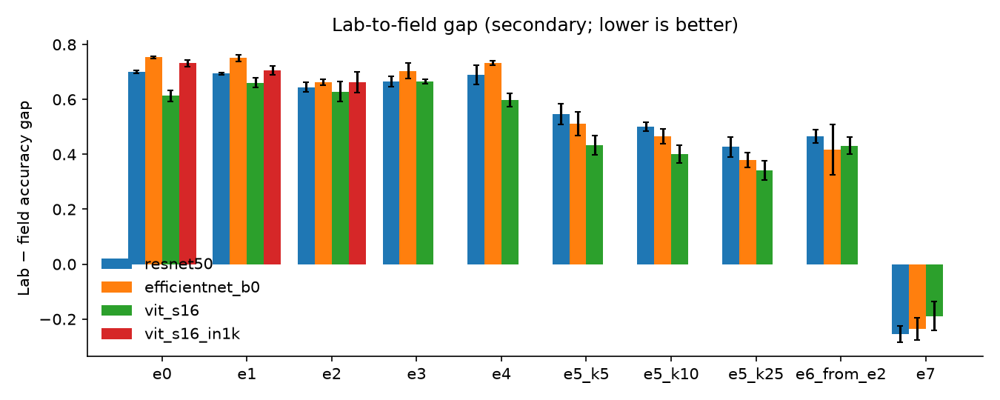

# Crop disease detection that works in real fields

> **Result:** _pending the final sweep._ Template: "Generative augmentation (**E?**) closes **X%** of the
> lab-to-field gap for EfficientNet-B0 (gap **A → B** points, PlantDoc test, N shared classes, 3 seeds); ten real
> field photos per class (E5, k=10) close **Y%**." Fill it in from `reports/results.md`; don't estimate.



*Gap = PlantVillage-test accuracy − PlantDoc-test accuracy on the shared classes. Lower is better. Mean ± std over 3 seeds.
Created by `python -m src.report`.*

## How to run (3 commands)

```bash
make setup data                                   # install, download PlantDoc, build manifests (HF PlantVillage)
python -m src.train --config configs/experiments/e0_baseline.yaml model=efficientnet_b0 seed=0
python -m src.report                              # -> reports/results.md, reports/figures/gap.png
```

Full sweep (E0–E7 × 3 models × 3 seeds): `make sweep`. Compute experiments: `make compute`. Deployment: `make deploy app`.

## Question

How much of the lab-to-field gap can generative augmentation (CycleGAN style transfer, conditional-VAE samples)
close, compared with plain augmentation and with fine-tuning on a few real field images?

## Data

| Dataset | Source | Role |
|---|---|---|
| PlantVillage (color) | HF `mohanty/PlantVillage` | Lab-domain training. HF splits keep photos of the same leaf together. |
| PlantVillage (segmented) | same repo, `segmented` | Leaf cutouts for background compositing (E2) |
| PlantDoc | GitHub `pratikkayal/PlantDoc-Dataset` (CC BY 4.0) | Field test set, field val set, few-shot pool |

Rules enforced in `src/data/prepare.py`:
- **Shared classes only.** `configs/class_map.csv` maps PlantDoc folders to PlantVillage classes (two PlantDoc soybean folders map to one class). The label space is the mapped classes that appear in both PlantVillage train and PlantDoc test. **Shared classes: _N_** (see `reports/data_summary.md`).
- **PlantDoc test is held out.** Early stopping, checkpoint selection, and the choice of E6's base experiment all use **PlantDoc-val**: a stratified 20% of PlantDoc train with a fixed split seed.
- **Near-duplicates removed.** Any PlantDoc-train image within pHash Hamming distance ≤ 4 of a test image is dropped. The pairs are listed in `reports/dedup_plantdoc.csv`.
- No TFDS. Its single ungrouped split leaks the same leaf across train and test.

## Baseline first

**E0** fine-tunes ImageNet-pretrained models on PlantVillage with standard augmentation. This is the lab number everyone quotes, and it measures the raw gap.
The practical bar every generative method has to beat is **E5 at k=10**: label ten field photos per class and fine-tune.
**E7** (PlantDoc only, no lab data) is the reference for what field data alone achieves.

## Experiments and results

Every row is evaluated once on **PlantDoc test** (shared classes), using the checkpoint chosen on PlantDoc-val. Values are mean ± std over seeds 0, 1, 2.
The full table, with macro-F1, ECE and every model, is in `reports/results.md`.

| ID | Training data | ResNet-50 PD acc | EffNet-B0 PD acc | ViT-S/16 PD acc | Gap (EffNet-B0) |
|---|---|---|---|---|---|
| E0 | PlantVillage, baseline aug | — | — | — | — |
| E1 | + RandAugment, MixUp/CutMix | — | — | — | — |
| E2 | + background compositing | — | — | — | — |
| E3 | + CycleGAN lab→field copies | — | — | — | — |
| E4 | + CVAE field-domain samples | — | — | — | — |
| E5 | E0 → fine-tune, k = 5 / 10 / 25 | — | — | — | — |
| E6 | best of E1–E4 (by val) → fine-tune k=10 | — | — | — | — |
| E7 | PlantDoc train only | — | — | — | — |

PlantDoc test has only a few hundred images in the shared classes. `metrics.json` therefore also stores a 95% bootstrap CI for every run's accuracy. Treat differences smaller than that as noise.

### Generated images

| | FID vs PlantDoc train ↓ |
|---|---|
| PlantVillage (no translation, reference) | — |
| CycleGAN lab→field | — |
| CVAE (field-domain samples) | — |

`reports/figures/cyclegan_grid.png` and `reports/figures/cvae_grid.png` hold 4×4 grids of samples. Numbers are in `reports/fid.json`.

### What the model looks at

Grad-CAM (CNNs) and attention rollout (ViT) on 20 fixed PlantDoc-test images: `python -m src.explain --runs runs/e0/... runs/e2/... runs/e3/...`
→ `reports/figures/saliency_<model>.png`. Hypothesis to check: E0 attends to background and leaf edges, while E2/E3 attend to lesions.

## Failure analysis

_Fill in after the sweep from per-class recall and confusion matrices in `metrics.json` and the saliency figures. One paragraph per failure mode, each with example images:_
- _Confusable diseases (e.g. tomato early vs. late blight, septoria vs. bacterial spot)._
- _Multiple leaves or cluttered frames: PlantDoc images often contain several leaves, while PlantVillage has exactly one._
- _Healthy-class over-prediction under heavy blur or low light._
- _Calibration: field-domain ECE vs. lab-domain ECE. Overconfident wrong answers are what the 0.5 "unsure" threshold is meant to catch._

## Compute-cost experiments

Results are in `reports/results.md` ("Compute experiments"), produced by `make compute`.

| Experiment | What is recorded |
|---|---|
| FP32 vs AMP (bf16), ResNet-50 and ViT-S | images/s, peak GPU memory, PlantDoc acc |
| Gradient checkpointing, ViT-S | memory saved vs. epoch time added |
| DDP 1 / 2 / 4 GPUs | throughput, scaling efficiency = thr_N / (N · thr_1), accuracy with linear lr scaling |
| `torch.profiler`, 1 epoch | top-5 ops (`profile_top5.txt`), fraction of step time spent waiting on the data loader |

## Deployment

The best EfficientNet-B0 (picked by PlantDoc-val) is exported to ONNX, then quantized to INT8 with ONNX Runtime static quantization (QDQ, per-channel, calibrated on 500 PlantDoc-train images).
`python -m serve.export` writes `reports/deploy.md`.

| Model | PlantDoc acc | Size (MB) | CPU p50 (ms) | CPU p95 (ms) |
|---|---|---|---|---|
| EfficientNet-B0 FP32 | — | — | — | — |
| EfficientNet-B0 INT8 | — | — | — | — |

Latency is measured at batch 1 with 4 intra-op threads (phone-class budget). The CPU model is recorded in `reports/deploy.json`.
Demo: Gradio on Hugging Face Spaces (`serve/app.py`, link TBD). It shows top-3 predictions with a Grad-CAM overlay, and answers **"unsure"** when the top confidence is below 0.5.
A FastAPI service with a Dockerfile is in `serve/`.

## Reproducibility

- Every run is launched from a YAML config (`configs/`) plus CLI overrides. The resolved config is saved next to the checkpoint (`runs/<exp>/<model>/seed<k>/config.yaml`).
- Seeds are fixed: Python, NumPy, torch and DataLoader workers. The PlantDoc-val split uses its own fixed seed, so it's the same for all runs. Few-shot draws vary with the training seed.
- Runs log to MLflow (`mlruns/`, `mlflow ui`). Switch to W&B with `logging.backend=wandb`.
- `pytest` covers metrics, splits, the class map, configs, model shapes and sizes, compositing, dedup, and an end-to-end CPU smoke test (train → eval → fine-tune → report) on synthetic images.

## Design decisions and deviations from the brief

- **Label space = shared classes** for every experiment, including E7, so all rows are scored on the same task.
- **ViT normalization:** the AugReg ViT-S/16 was pretrained with mean/std 0.5, so its own stats are used. The CNNs use ImageNet stats.
- **CycleGAN epoch = |PlantDoc train| iterations** (~1.8k), with PlantVillage images sampled at random. PlantVillage is about 20× larger, so a full pass over it per epoch would blow the 10–15 GPU-hour budget.
- **CVAE is conditioned on (class, domain)** with domain-balanced sampling. It is trained per crop group and sampled in the *field* domain, 500 images per class.
- **Fine-tuning hyperparameters (E5/E6)** were fixed before seeing any results: lr × 0.3, batch 32, 30 epochs, 2 warm-up epochs, early stopping on val.
- The brief names the *cropped* PlantDoc classification set. `scripts/download_data.sh` clones the GitHub repo. If you use a cropped export instead, point `paths.plantdoc_dir` at it; the folder structure is the same.

## Limitations

- PlantDoc test is small and noisy: web-scraped, with some label errors and multi-leaf images. Per-class numbers for rare classes are unreliable.
- Coverage is limited to the shared classes. The model has never seen other crops and diseases and will force them into a known class. The "unsure" threshold helps but doesn't solve open-set inputs.
- Generative models are trained on PlantDoc *train* images, so E3 and E4 see unlabeled field-domain data. They aren't "zero field data" methods, and the comparison with E5 should be read that way.
- Latency is on a desktop/server CPU with constrained threads, not a measured phone (TFLite on Android is optional and not yet done).

## Compute budget

| Item | Estimate |
|---|---|
| Classifiers: 3 models × 10 runs (E0–E7, E5 at 3 values of k) × 3 seeds, 1–2 A40-hours each | 50–70 GPU-h (use 1 seed while exploring) |
| CycleGAN | 10–15 GPU-h |
| CVAE | 3–5 GPU-h |
| DDP scaling (multi-GPU RunPod pod) | ~4 h |

Prototype on Colab or a local GPU, and run the final sweeps on RunPod (A40 or A100).

## Repo layout

```
configs/      base.yaml, experiments/e0–e7, compute/, cyclegan.yaml, cvae.yaml, deploy.yaml, class_map.csv
src/data/     prepare (manifests, dedup, splits), datasets, transforms, compositing
src/models/   classifier (timm), cyclegan, cvae
src/          train.py, eval.py, metrics.py, train_cyclegan.py, train_cvae.py, generate.py, fid.py, explain.py, report.py
serve/        export (ONNX + INT8 + latency), predictor, Gradio app, FastAPI api, Dockerfile
notebooks/    analysis only
reports/      figures + results tables (generated)
tests/        pytest
scripts/      download, full sweep, compute experiments
```
