# Failure analysis (PlantDoc test)

Built from saved predictions of 33 experiment×model cells. Test set: 236 images, 27 classes, 4–12 per class, so **per-class numbers are noisy**: one image is ~11 points of a class's recall.

## resnet50

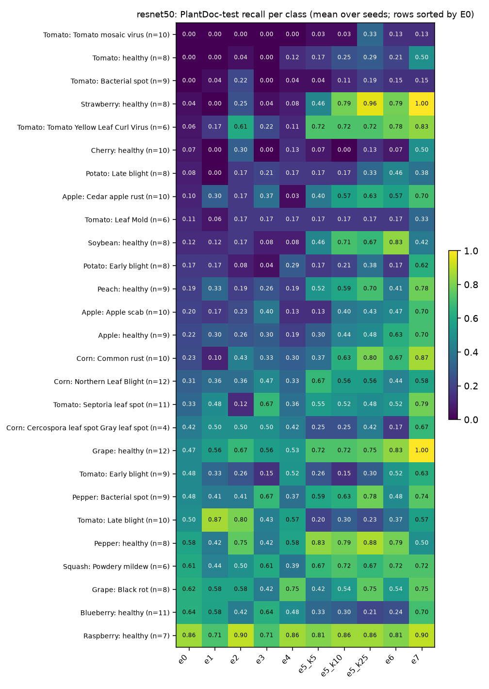

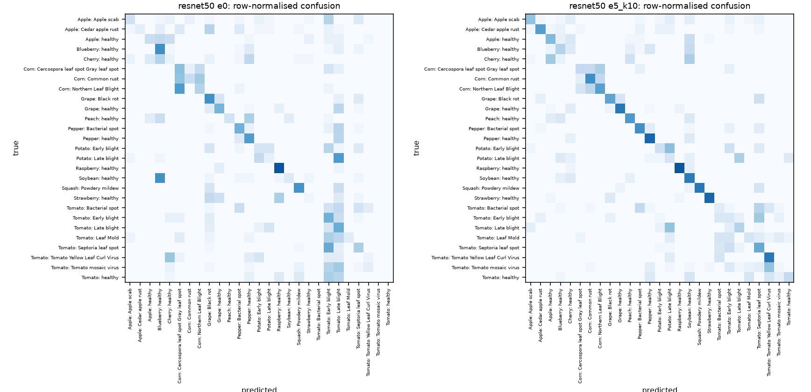

Most frequent E0 (lab-only) confusions, images per seed:

| true | predicted as | count |
|---|---|---|
| Corn: Northern Leaf Blight | Corn: Cercospora leaf spot Gray leaf spot | 7.0 |
| Tomato: Septoria leaf spot | Tomato: Early blight | 5.7 |
| Soybean: healthy | Blueberry: healthy | 5.0 |
| Potato: Late blight | Tomato: Late blight | 4.7 |
| Corn: Common rust | Corn: Cercospora leaf spot Gray leaf spot | 4.0 |
| Corn: Common rust | Corn: Northern Leaf Blight | 3.7 |
| Tomato: Tomato mosaic virus | Tomato: Late blight | 3.7 |
| Grape: healthy | Tomato: Late blight | 3.3 |

Prediction collapse (E0): the 3 most-predicted classes take **38%** of all predictions (Tomato: Late blight 16%, Tomato: Early blight 13%, Blueberry: healthy 9%); uniform would be 11%.

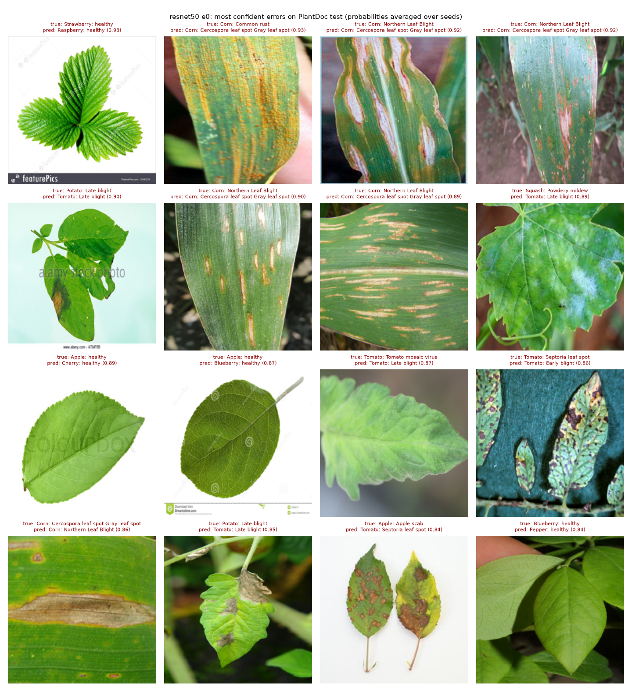

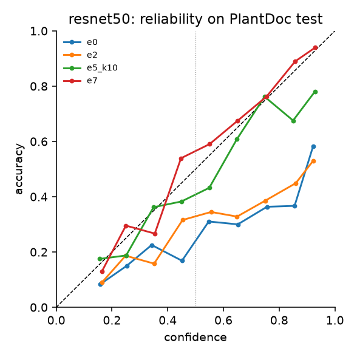

## efficientnet_b0

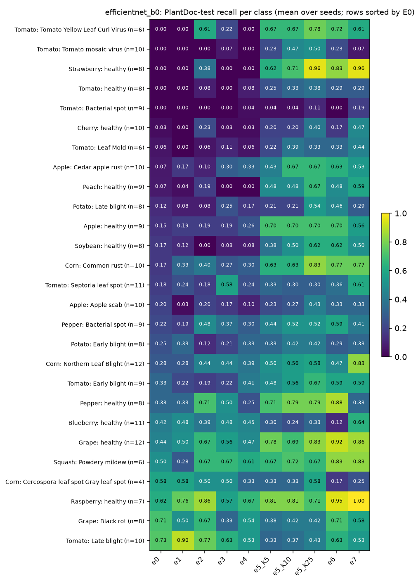

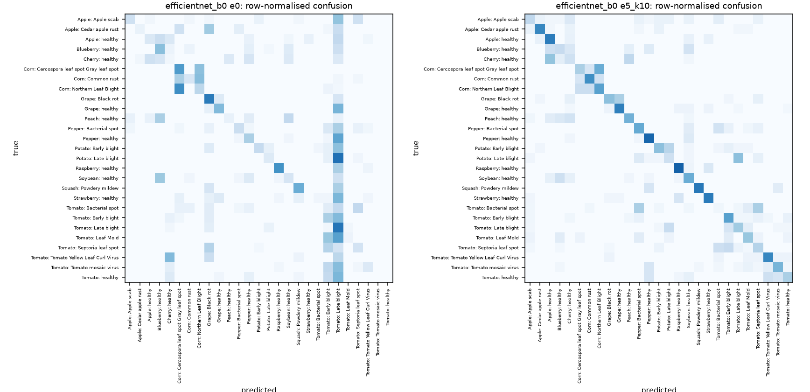

Most frequent E0 (lab-only) confusions, images per seed:

| true | predicted as | count |
|---|---|---|
| Corn: Northern Leaf Blight | Corn: Cercospora leaf spot Gray leaf spot | 7.7 |
| Potato: Late blight | Tomato: Late blight | 6.0 |
| Grape: healthy | Tomato: Late blight | 5.7 |
| Pepper: healthy | Tomato: Late blight | 4.3 |
| Tomato: Tomato mosaic virus | Tomato: Late blight | 4.3 |
| Corn: Common rust | Corn: Northern Leaf Blight | 4.3 |
| Tomato: Early blight | Tomato: Late blight | 4.0 |
| Apple: Apple scab | Tomato: Late blight | 4.0 |

Prediction collapse (E0): the 3 most-predicted classes take **49%** of all predictions (Tomato: Late blight 32%, Grape: Black rot 9%, Tomato: Early blight 8%); uniform would be 11%.

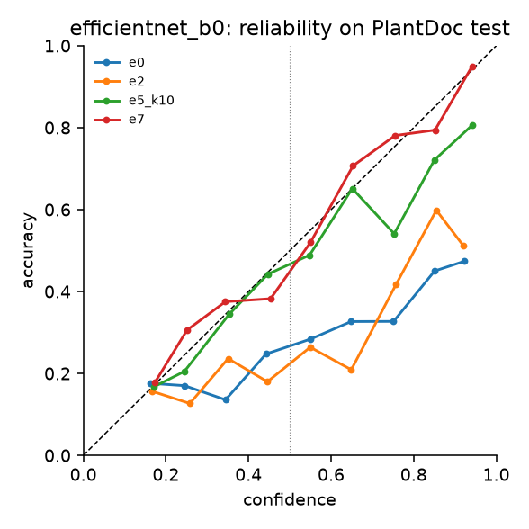

## vit_s16

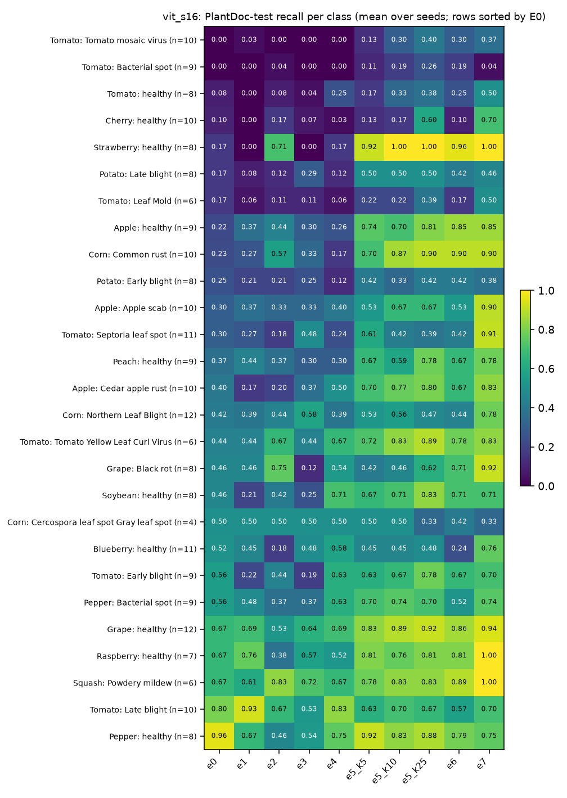

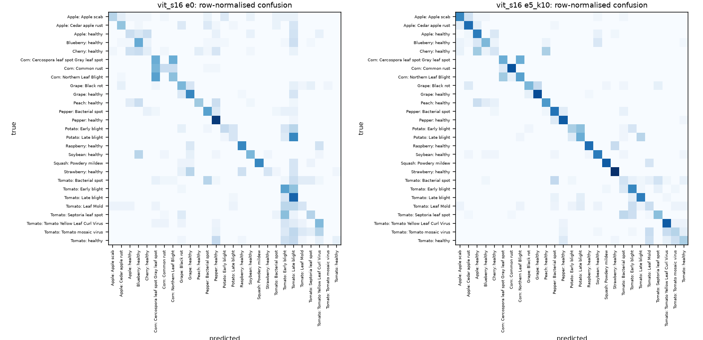

Most frequent E0 (lab-only) confusions, images per seed:

| true | predicted as | count |
|---|---|---|
| Corn: Northern Leaf Blight | Corn: Cercospora leaf spot Gray leaf spot | 6.7 |
| Potato: Late blight | Tomato: Late blight | 5.3 |
| Tomato: Septoria leaf spot | Tomato: Early blight | 4.7 |
| Corn: Common rust | Corn: Cercospora leaf spot Gray leaf spot | 4.7 |
| Tomato: Early blight | Tomato: Late blight | 3.7 |
| Tomato: Tomato mosaic virus | Tomato: Tomato Yellow Leaf Curl Virus | 3.0 |
| Tomato: Tomato mosaic virus | Tomato: Late blight | 2.7 |
| Tomato: Bacterial spot | Pepper: Bacterial spot | 2.7 |

Prediction collapse (E0): the 3 most-predicted classes take **35%** of all predictions (Tomato: Late blight 18%, Tomato: Early blight 9%, Pepper: healthy 8%); uniform would be 11%.

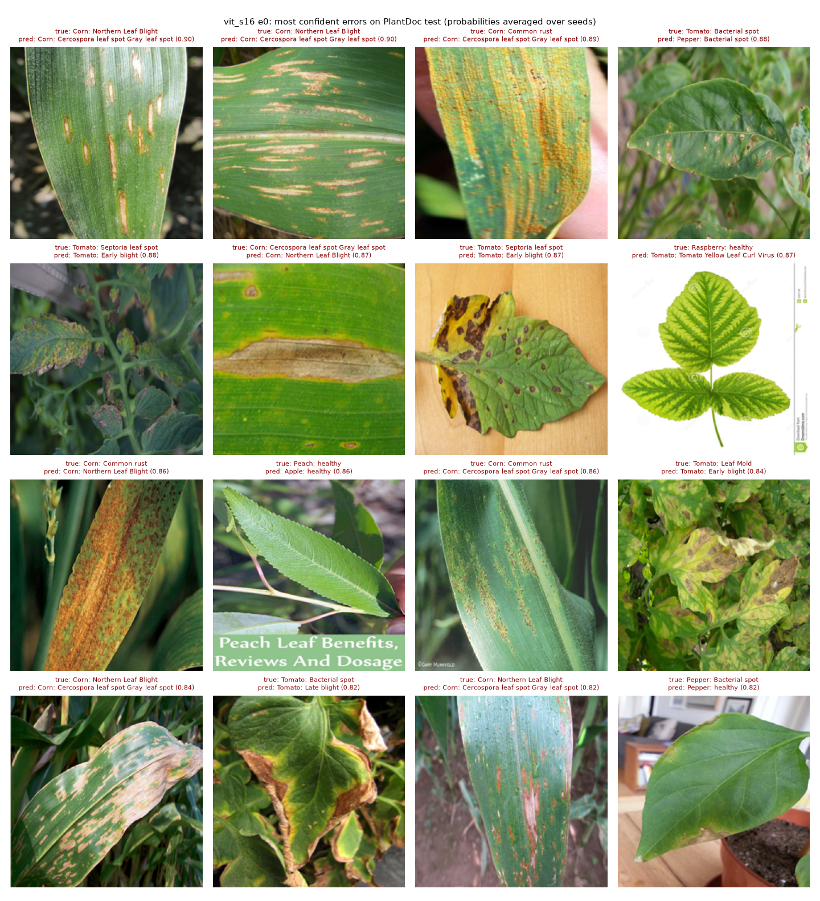

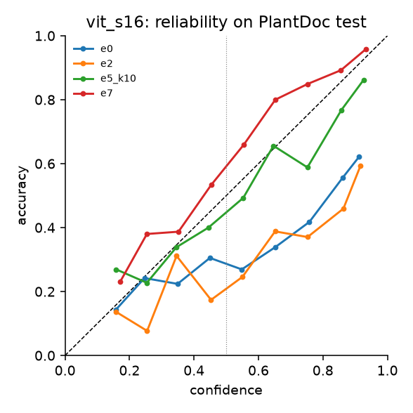

## vit_s16_in1k

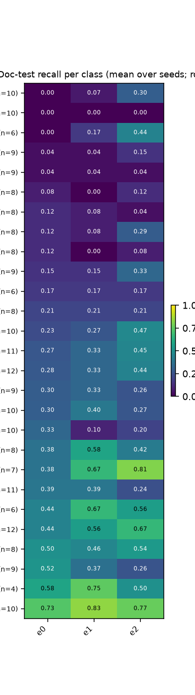

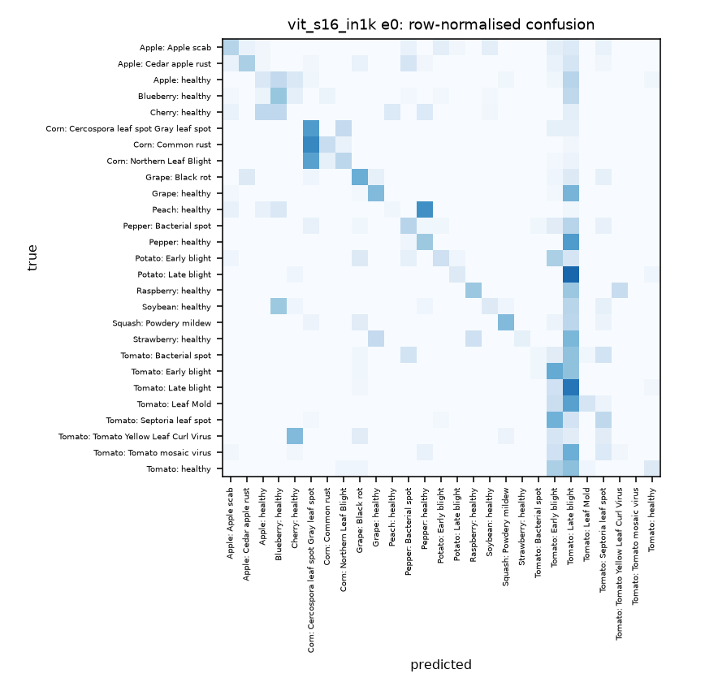

Most frequent E0 (lab-only) confusions, images per seed:

| true | predicted as | count |
|---|---|---|
| Corn: Northern Leaf Blight | Corn: Cercospora leaf spot Gray leaf spot | 6.7 |
| Corn: Common rust | Corn: Cercospora leaf spot Gray leaf spot | 6.7 |
| Potato: Late blight | Tomato: Late blight | 6.3 |
| Grape: healthy | Tomato: Late blight | 5.7 |
| Peach: healthy | Pepper: healthy | 5.7 |
| Tomato: Septoria leaf spot | Tomato: Early blight | 5.3 |
| Tomato: Tomato mosaic virus | Tomato: Late blight | 5.0 |
| Pepper: healthy | Tomato: Late blight | 4.7 |

Prediction collapse (E0): the 3 most-predicted classes take **50%** of all predictions (Tomato: Late blight 31%, Tomato: Early blight 12%, Corn: Cercospora leaf spot Gray leaf spot 8%); uniform would be 11%.

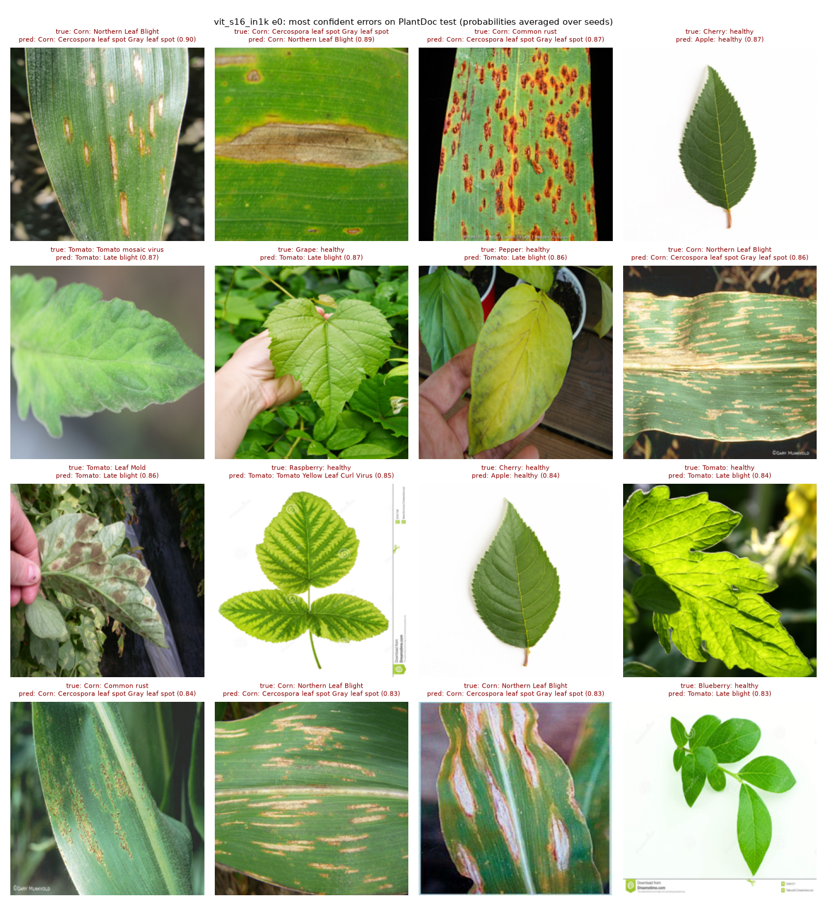

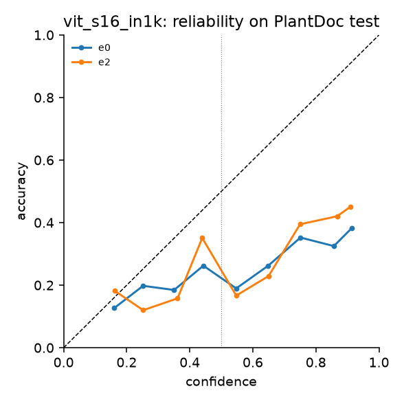

## Classes that stay hard even with 25 field images per class (e5_k25)

| class | n test | resnet50 | efficientnet_b0 | vit_s16 |
|---|---|---|---|---|
| Tomato: Bacterial spot | 9 | 0.19 | 0.11 | 0.26 |
| Tomato: Leaf Mold | 6 | 0.17 | 0.33 | 0.39 |
| Blueberry: healthy | 11 | 0.21 | 0.33 | 0.48 |
| Tomato: healthy | 8 | 0.29 | 0.38 | 0.38 |
| Cherry: healthy | 10 | 0.13 | 0.40 | 0.60 |
| Tomato: Septoria leaf spot | 11 | 0.48 | 0.30 | 0.39 |
| Potato: Early blight | 8 | 0.38 | 0.42 | 0.42 |
| Tomato: Tomato mosaic virus | 10 | 0.33 | 0.50 | 0.40 |

## Where 10 field images per class help least / most (recall change E0 → E5 k=10, mean over models)

| least helped | Δ recall | most helped | Δ recall |
|---|---|---|---|
| Tomato: Late blight | -0.22 | Strawberry: healthy | +0.76 |
| Blueberry: healthy | -0.19 | Tomato: Tomato Yellow Leaf Curl Virus | +0.57 |
| Corn: Cercospora leaf spot Gray leaf spot | -0.14 | Corn: Common rust | +0.50 |
| Grape: Black rot | -0.13 | Apple: Cedar apple rust | +0.48 |
| Tomato: Early blight | +0.00 | Apple: healthy | +0.42 |
| Cherry: healthy | +0.06 | Soybean: healthy | +0.39 |

Manual test-label review loaded (236 images): errors on images whose label was judged wrong are marked in the error grids.
