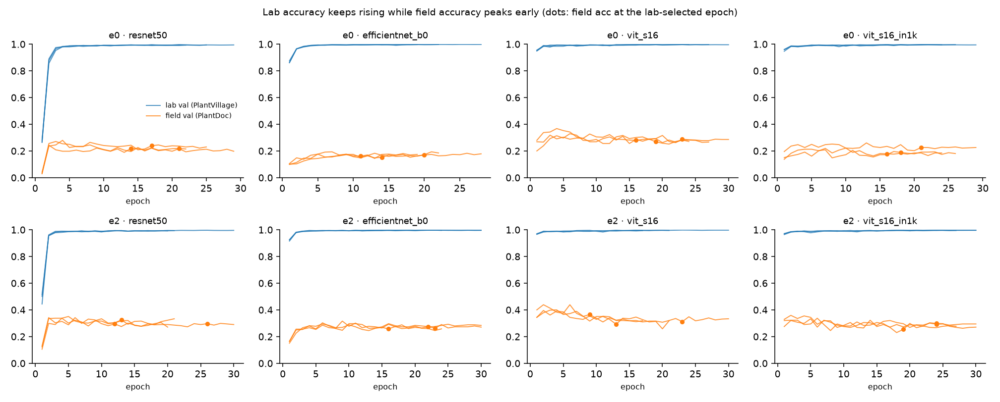

# Lab vs field validation curves

Field-val accuracy at the lab-selected checkpoint vs the field-val peak (mean over seeds). The difference is how much choosing checkpoints on field data would flatter a lab-only model.

|                           |   field_val_at_lab_selected |   field_val_peak |   peak_epoch |   lab_selected_epoch |   seeds |   optimism_if_selected_on_field_val |
|:--------------------------|----------------------------:|-----------------:|-------------:|---------------------:|--------:|------------------------------------:|
| ('e0', 'efficientnet_b0') |                       0.161 |            0.189 |       15     |               15     |       3 |                               0.028 |
| ('e0', 'resnet50')        |                       0.225 |            0.265 |        3     |               17.333 |       3 |                               0.039 |
| ('e0', 'vit_s16')         |                       0.279 |            0.338 |        4.333 |               19.333 |       3 |                               0.059 |
| ('e0', 'vit_s16_in1k')    |                       0.198 |            0.232 |        9     |               18.333 |       3 |                               0.034 |
| ('e2', 'efficientnet_b0') |                       0.265 |            0.305 |        7     |               20.333 |       3 |                               0.04  |
| ('e2', 'resnet50')        |                       0.305 |            0.343 |        3.667 |               17     |       3 |                               0.038 |
| ('e2', 'vit_s16')         |                       0.323 |            0.411 |        2.667 |               15     |       3 |                               0.088 |
| ('e2', 'vit_s16_in1k')    |                       0.282 |            0.343 |        4.333 |               22.333 |       3 |                               0.062 |
